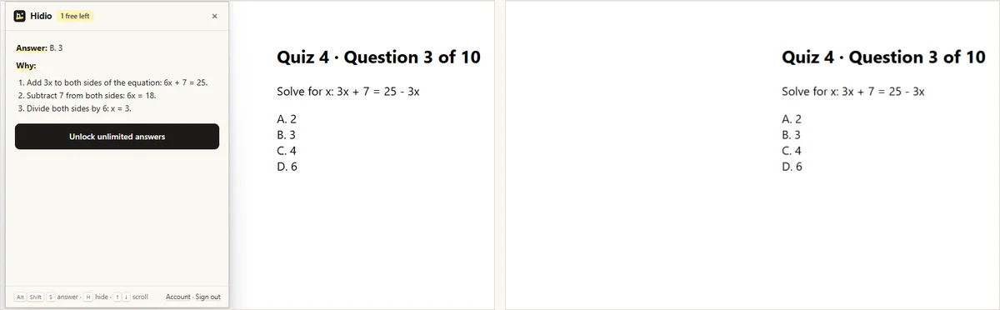

# Hidio

**Screenshot a question, get the answer with the full working.** Hidio is a homework and quiz helper for Windows and macOS: press `Alt + Shift + S` (`Option + Shift + S` on a Mac) and the answer, with every step, appears in a small window beside the question.

[Website](https://hidio.app) · [Install guide](https://hidio.app/install/) · [Web version](https://hidio.app/app/) · [Press kit](https://hidio.app/press/)



## Downloads

| Platform | Version | File | Size |
|---|---|---|---|
| Windows 10 (2004+) and Windows 11 | 0.1.1 | `Hidio_0.1.1_x64-setup.exe` | 1.7 MB |
| macOS 11+, Apple Silicon and Intel | 0.2.0 | `Hidio_0.2.0_universal.dmg` | 4.2 MB |

Both files are on the [Releases](../../releases) page of this repository and on [hidio.app/install](https://hidio.app/install/). The two copies are byte-identical:

```
10258f00c14735520223da3f54ab92e318ff95a539f917e7ef11ae04238891f0  Hidio_0.1.1_x64-setup.exe
e8363c90f2ead1e350707547e4bbed52b53ed71e8275f6d83bc845651f00c99d  Hidio_0.2.0_universal.dmg
```

The Windows build is not code-signed yet, so Windows shows **“Windows protected your PC”** the first time it runs: click **More info**, then **Run anyway**. It installs for the current user and does not need administrator rights.

On macOS, the first screenshot asks for Screen Recording permission in System Settings; Hidio shows a button that opens the right pane.

## How it works

1. Open the question on screen — a quiz, a PDF, a Word document, a spreadsheet, any application.
2. Press `Alt + Shift + S` (`Option + Shift + S` on macOS). Hidio captures the display the pointer is on.
3. The answer arrives in a floating window with the full solution, in the language of the question. Ask a follow-up on any step if something is unclear.

`Alt + Shift + H` (`Option + Shift + H`) hides or shows the window; the arrow keys scroll a long answer.

Hidio reads the screen rather than the page, so it behaves the same in Canvas, Google Forms, McGraw Hill Connect, Pearson MyLab, a PDF or an editor, and no extension or browser integration is involved.

## What the floating window does around screenshots and screen sharing

- **Windows:** the window is excluded from screenshots, recordings and screen sharing, including full-screen sharing. It is still visible to a camera pointed at the display, and to anyone physically looking at the screen. Clicking the window does not take focus away from the page behind it.
- **macOS:** screenshots and sharing a single window do not include the window. On macOS 15 and later, full-screen sharing may include it, so share the window or tab that holds the question instead of the entire screen.

## Requirements

- Windows 10 version 2004 or later, or Windows 11.
- macOS 11 or later; one universal build runs on Apple Silicon and Intel.
- An account (email and a six-digit code) and a network connection. Answers stream as they are generated.

## Pricing

Five answers are free without a card. After that: **$7.99 per week** or **$19.99 per month**, cancel any time from the account page. Paid accounts can request up to 400 answers a day.

The same account works in the browser at [hidio.app/app](https://hidio.app/app/), where a screenshot can be pasted on any device, including phones and Chromebooks.

## Support

- Email: support@hidio.app
- Terms: https://hidio.app/terms/ · Privacy: https://hidio.app/privacy/ · Refunds: https://hidio.app/refunds/

This repository distributes the installers and the release notes. Hidio is proprietary software; the binaries may be downloaded and used under the terms of service, and the source is not published here.
